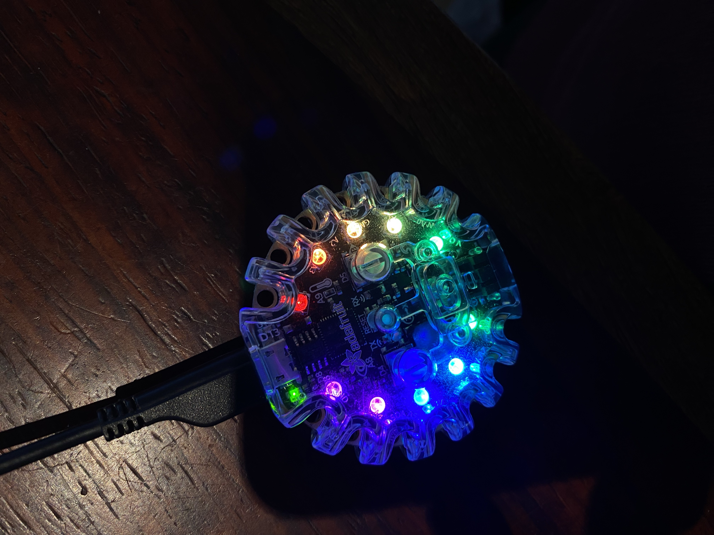
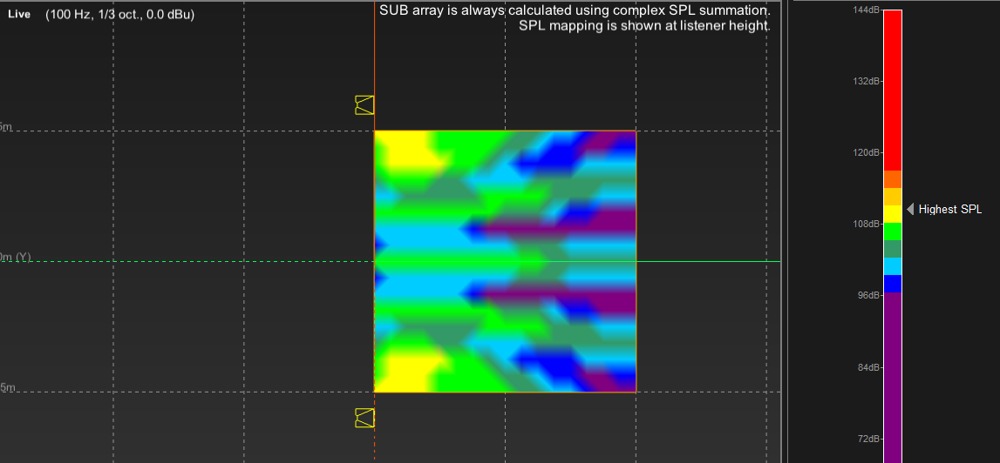

# dBviewNeoPixels - Standing Wave Visualizer

A portable acoustic measurement tool for visualizing standing waves and acoustic interference patterns in rooms using NeoPixel LEDs.



## Overview

**dBviewNeoPixels** transforms your Adafruit Circuit Playground M0 into a handheld acoustic analyzer. Walk around a room and watch 10 color-coded NeoPixel LEDs display the acoustic energy at your target frequency in real-time. 

Perfect for:
- 🎼 Visualizing room modes and standing waves
- 🎵 Identifying acoustic "hot spots" where bass accumulates
- 📊 Correlating physical measurements with acoustic simulations (ArrayCalc, etc.)
- 🏠 Acoustic treatment planning and optimization

## Hardware

| Component | Model | Purpose |
|-----------|-------|---------|
| Microcontroller | Adafruit Circuit Playground M0 | Core processor + 10 NeoPixel LEDs |
| Microphone | Built-in (A4 pin) | Audio input @ 1 kHz sampling rate |
| Slide Switch | Built-in | Fast/Slow response time toggle |
| Buttons | Left/Right (built-in) | ±3 dB scale offset adjustment |

## Features

✅ **Real-time Acoustic Visualization**
- 10 color-coded NeoPixel LEDs (Violet → Blue → Green → Yellow → Red)
- Each LED step = +3 dB SPL
- Dynamic range: 0 to 30 dB

✅ **Bandpass Filtering**
- 100 Hz center frequency with Q=6 (sharp selectivity)
- Isolates target frequency from background noise
- Post-filter normalization for consistent scaling

✅ **IEC 61672-1 Time Weighting**
- **FAST mode**: τ = 125 ms (responsive, ~0.6s convergence)
- **SLOW mode**: τ = 1 s (analog VU-meter style, ~5s convergence)
- Toggle via slide switch

✅ **Manual Offset Adjustment**
- Left button: +3 dB offset
- Right button: -3 dB offset
- Real-time scale shifting without recalibration

✅ **Serial Monitoring**
- Debug mode outputs raw and smoothed dB values
- Change notifications for offset and mode switches

## Color Scale

This color scale is identical to the one used in **d&b ArrayCalc**, ensuring visual consistency between your acoustic simulations and real-world measurements.

| LED # | Color | dB Range | Meaning |
|-------|-------|----------|---------|
| 0 | Violet (Dark) | 0-3 | Threshold |
| 1 | Violet (Bright) | 3-6 | Faint |
| 2 | Blue (Dark) | 6-9 | Quiet |
| 3 | Blue (Bright) | 9-12 | Moderate |
| 4 | Green (Dark) | 12-15 | Medium |
| 5 | Green (Bright) | 15-18 | Strong |
| 6 | Yellow (Gold) | 18-21 | Very Strong |
| 7 | Orange (Bright) | 21-24 | Intense |
| 8 | Orange (Dark) | 24-27 | Peak |
| 9 | Red | 27-30+ | Maximum |



## Usage Instructions

### 1. **Calibration**

- Power on or reset the device
- **3 blue flashes** → Calibration starting
- **Silence** → Acoustic measurement in progress (LEDs off = no EM interference)
- Keep **silent** while calibration runs (1 second)
- **2 blue flashes** → Calibration complete ✓
- Serial monitor displays: `Calibration post-filtre terminee. Niveau SPL de base: XX.XX`

### 2. **Basic Operation**

1. **Target Frequency**: Currently set to **100 Hz**
   - Modify `target_frequency_hz` in code to measure different frequencies (20-200 Hz)
   
2. **Measure**: Walk around your room with the device
   - LEDs light up where acoustic energy is strongest
   - Watch for "hot spots" where bass accumulates
   
3. **Fine-tune Response Time**:
   - **Slide switch RIGHT** → FAST mode (reactive, ~0.6s)
   - **Slide switch LEFT** → SLOW mode (analog feel, ~5s)
   
4. **Adjust Sensitivity**:
   - **Left button** → Shift scale UP by 3 dB (see more detail in quiet areas)
   - **Right button** → Shift scale DOWN by 3 dB (prevent LED saturation in loud areas)

### 3. **Serial Monitoring**

Connect via USB (115200 baud) to see:

**Normal Output**:
```
Mode: FAST
Offset: 3.00 dB
Offset: 0.00 dB
Mode: SLOW
```

**Debug Output** (set `DEBUG_MODE 1` in code):
```
FAST | Instantane_dB:2.34 | Lisse_dB:1.45
FAST | Instantane_dB:2.45 | Lisse_dB:1.89
```

## Technical Specifications

| Parameter | Value | Notes |
|-----------|-------|-------|
| **Sampling Rate** | 1000 Hz (1 ms) | Limited by Arduino ADC |
| **Center Frequency** | 100 Hz | Configurable (20-200 Hz) |
| **Filter Q** | 6.0 | Sharp bandpass, ±1 octave |
| **Filter Type** | Biquad IIR | Efficient real-time processing |
| **Time Constant (Fast)** | 125 ms | IEC 61672-1 standard |
| **Time Constant (Slow)** | 1 s | IEC 61672-1 standard |
| **Reference Level** | Auto-calibrated | ~1000 samples at boot |
| **Dynamic Range** | 30 dB | 0-10 LEDs @ 3 dB/LED |
| **Display Update** | ~67 Hz | Smoothed output at 1 kHz input |

## Workflow: Correlating with ArrayCalc

### Example: Measuring 80 Hz Mode

1. **In ArrayCalc**:
   - Simulate your room geometry
   - Predict 80 Hz mode pattern (nulls and peaks)
   
2. **With dBviewNeoPixels**:
   - Upload code with `target_frequency_hz = 80.0`
   - Play 80 Hz test tone through a subwoofer
   - Walk the predicted path with the device
   - Observe LED lighting pattern
   
3. **Comparison**:
   - ✅ Match = Your simulation matches reality → acoustic treatment can be planned
   - ❌ Mismatch = Re-examine room geometry or check for obstacles

## Configuration

Edit `main.cpp` to customize:

```cpp
// Frequency
float target_frequency_hz = 100.0;    // Change to 50-150 Hz range

// Filter sharpness
float Q = 6.0;                         // Higher Q = sharper peak

// Time weighting (tau in seconds)
#define TAU_FAST 0.125                 // 125 ms (Fast response)
#define TAU_SLOW 1.0                   // 1 s (Slow response)

// LED scale
const float DB_PER_LED = 3.0;          // Sensitivity per LED

// Debug output
#define DEBUG_MODE 0                   // Set to 1 for continuous dB values
```

## Building & Uploading

### Prerequisites
- PlatformIO (or Arduino IDE)
- Adafruit Circuit Playground M0 drivers

### Build
```bash
pio run
```

### Upload
```bash
pio run --target upload
```

### Serial Monitor
```bash
pio device monitor --baud 115200
```

## Dependencies

| Library | Version | Purpose |
|---------|---------|---------|
| Adafruit Circuit Playground | 1.11.5 | Microcontroller + LEDs + buttons |
| Adafruit NeoPixel | (included) | LED control |
| Arduino (SAMD core) | >= 1.6.0 | SAMD21 support |

## License

This project is licensed under the **MIT License** - see LICENSE file for details.

Educational use encouraged! Share improvements and modifications.

## Credits

- **Inspiration**: Acoustic room mode visualization
- **Design**: Standing wave analysis for bass management
- **Framework**: PlatformIO + Adafruit libraries
- **Standards**: IEC 61672-1 audio weighting

## Troubleshooting

### LEDs don't respond to sound
- ❓ Check microphone isn't blocked
- ❓ Ensure target frequency matches your test tone
- ❓ Verify `reference_level` in serial monitor (should be > 0.5)

### LEDs stay at maximum
- ❓ Press right button to lower sensitivity
- ❓ Reduce volume of test source
- ❓ Check filter coefficients in debug output

### Slow response
- ❓ Switch to FAST mode (slide right)
- ❓ Increase `SMOOTHING_FACTOR_FAST` value (larger = faster)

### Noisy measurements
- ❓ Use SLOW mode for stable readings
- ❓ Increase Q factor for sharper filtering
- ❓ Perform fresh calibration (reboot)

## Future Enhancements

- [ ] Sweep mode (auto-scan frequencies 20-200 Hz)
- [ ] Data logging to SD card
- [ ] Bluetooth output for spectral display on phone
- [ ] Automatic room resonance detection
- [ ] Multi-frequency simultaneous display (3D mode)

---

**Made with ❤️ for acoustic enthusiasts and audio engineers.**

Questions? Issues? Contributions welcome on GitHub!
